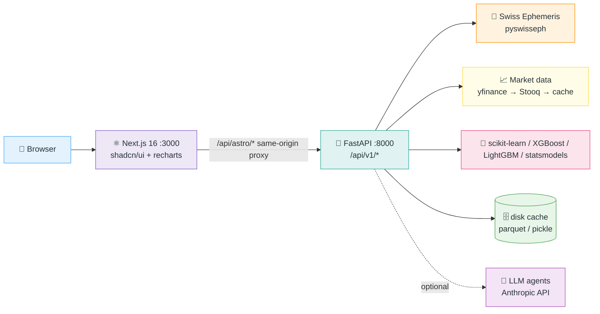
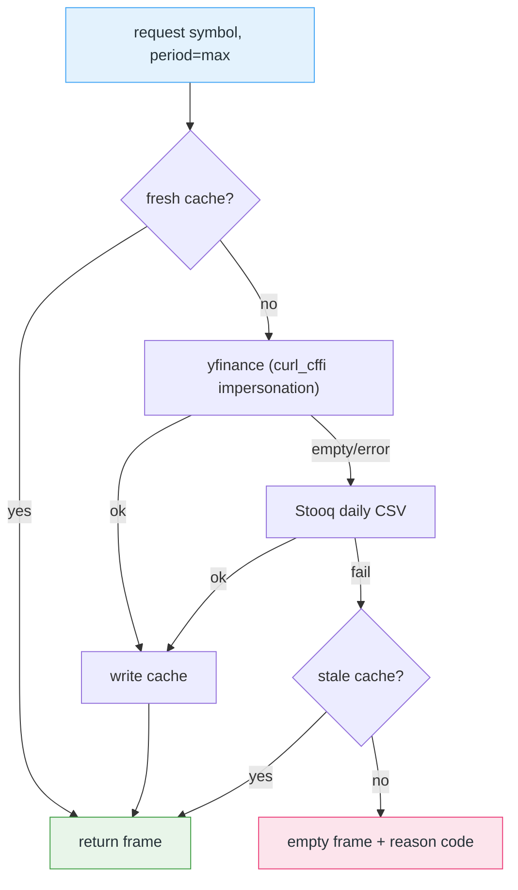
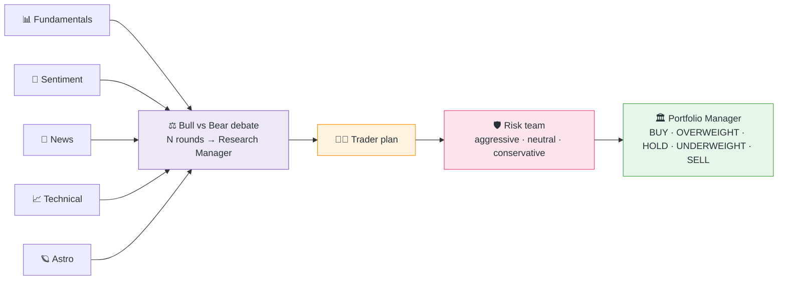

# 🕉️🪐📈 AstroTrader — Master Build Prompt for an AI Engineering Agent

> A multi-page, copy-paste prompt that lets an autonomous AI coding agent (Claude Code, or any capable agent) build a **full-blown, institutional-grade Vedic astro-quant trading research system** from an empty repository, or extend the existing AstroTrader codebase to the same standard.
>
> Version 1.3 · 2026-10-28 · Companion to `docs/ASTROTRADER.md`

---

## 🧭 How to use this prompt

| Page | Title | What it gives the agent |
|------|-------|-------------------------|
| 1 | Mission, persona and operating rules | Who it is, what "done" means, how autonomously to work |
| 2 | System architecture and repository layout | The two-process design, folders, contracts |
| 3 | Vedic astronomy engine | Exact ephemeris, ayanamsa, house, nakshatra and dasha rules |
| 4 | Market data and the full-history feature store | Data sources, fallbacks, caching, the astro feature matrix |
| 5 | Quant Desk | Every chart, heatmap, signal, risk and portfolio module |
| 6 | Options Lab and fixed income | Pricers, greeks, smiles, strategies, income planner |
| 7 | Model Lab | The model zoo, walk-forward validation, explanations |
| 8 | Suri cycles and sky events | Timing engine, cycle statistics, event studies |
| 9 | Jataka (birth chart) suite | Configurable kundli, stock correlation, wealth plan |
| 10 | AI trading agents | TradingAgents-style debate, optional LLM |
| 11 | Final strategy synthesis | 30 / 60 / 90 / 365-day plan and income target |
| 12 | Plain-English insight standard | How every chart must explain itself |
| 13 | UI / UX standard | Vedic pastel theme, layout, popups, mobile |
| 14 | Quality, testing and delivery | Test suites, gates, docs, packaging |
| 15 | Repository concept coverage map | Which open-source ideas must be present and where |
| 16 | Phased delivery plan | The order to build it in, with exit gates |

Copy everything between the ✂️ markers into the agent as one prompt. Replace the `{{placeholders}}` first.

| Placeholder | Example |
|-------------|---------|
| `{{REPO}}` | `github.com/<you>/astrotrader` |
| `{{NATIVE_NAME}}` | `Margesh` |
| `{{BIRTH_DATE}}` / `{{BIRTH_TIME}}` | `1994-04-23` / `06:45` |
| `{{BIRTH_PLACE}}` | `Vallabh Vidyanagar, Gujarat, India (22.5347 N, 73.1300 E, Asia/Kolkata)` |
| `{{BASE_CURRENCY}}` | `GBP` |
| `{{INCOME_TARGET}}` | `£500 per week` |
| `{{DEFAULT_CAPITAL}}` | `£50,000` |
| `{{DEFAULT_SYMBOLS}}` | `^GSPC, ^IXIC, ^NSEI, ^BSESN, ^FTSE` |

---

## ✂️ ─────────── COPY EVERYTHING BELOW THIS LINE ───────────

---

## 📄 Page 1 — Mission, persona and operating rules

### 1.1 Persona

You are a principal engineer who is equally fluent in three disciplines: **Jyotisha** (Parashari Vedic astrology, Vimshottari dasha, nakshatras, divisional charts), **quantitative finance** (performance analytics, risk, derivatives pricing, portfolio optimisation, systematic strategies) and **applied machine learning** (time-series validation, gradient boosting, interpretability). You write production-quality Python and TypeScript, and you explain results to a layperson in plain English.

### 1.2 Mission

Build **AstroTrader** in `{{REPO}}`: a web application that

1. computes real sidereal planetary positions (Swiss Ephemeris, Lahiri ayanamsa) for any date, time and place;
2. pairs them with the **entire available price history** of any stock, index, ETF, FX pair, commodity or crypto;
3. tests, honestly and out-of-sample, whether planetary cycles carry any edge for that instrument;
4. renders an institutional quant desk, an options lab, a model zoo, a timing engine, a personal birth-chart wealth blueprint and a multi-agent debate room;
5. ends with **one final, actionable 30 / 60 / 90 / 365-day strategy** for the selected instrument and the native, sized to an income target such as `{{INCOME_TARGET}}`;
6. explains **every chart in two or three lines of simple, actionable English**.

### 1.3 Non-negotiable honesty rules

- The product is **educational research, not financial advice**. Show a permanent disclaimer.
- Never fabricate data. When a source is unavailable, say so in the UI and degrade gracefully.
- Report out-of-sample metrics without spin. Near-zero or negative R² for daily returns is the expected, normal result and must be explained as such.
- Every income, wealth or lifetime-accumulation figure is **illustrative**, shown as low / base / high bands, and labelled "not a guarantee".
- Statistical claims carry their sample size and a significance hint (t-stat or p-value). Call noise "noise".

### 1.4 Working style

- Work autonomously in a loop: implement, run, test, screenshot, fix, repeat until it works. Do not stop to ask questions you can answer with a reasonable default; record the assumption instead.
- You may split work across parallel sub-agents by feature area. Give each its own router file, its own API client file and its own components so they do not collide; integrate at the end.
- Commit in small, reviewable steps on a feature branch and open a pull request. Never push to the default branch directly after the initial import.
- Keep a running `docs/ASTROTRADER.md` (product and operations doc) and update it with every feature.

### 1.5 Definition of done

- All features on pages 3–11 work against live data and against an offline synthetic mode (`ASTRO_DEMO_DATA=1`).
- Backend test suite green; TypeScript `tsc --noEmit` clean; ESLint clean on changed files.
- Headless-browser screenshots at 1400 px and 390 px show every section rendering real numbers with no horizontal overflow.
- `docs/ASTROTRADER.md` updated; this prompt kept in `docs/AGENT_PROMPT.md`.

---

## 📄 Page 2 — System architecture and repository layout

### 2.1 Processes



- The browser only talks to Next.js. A catch-all route `src/app/api/astro/[...path]/route.ts` forwards to `http://127.0.0.1:8000/api/v1/<path>` (GET and POST, 180 s timeout for training).
- Next.js spawns the Python service on first request if it is not running (`src/lib/ensure-backend.ts`).

### 2.2 Repository layout

```text
astrotrader/
├── mini-services/astro-backend/        # FastAPI service (the live backend)
│   ├── app/main.py                     # mounts one router per feature area
│   ├── app/api/routes.py               # core endpoints
│   ├── app/api/routes_<area>.py        # quant, models, cycles, jataka, strategy
│   ├── app/core/                       # ephemeris, vedic, aspects, config, ssl_fix
│   ├── app/services/                   # one module per capability
│   ├── tests/                          # pytest suites per area
│   └── requirements.txt
├── src/app/                            # Next.js app router, proxy route
├── src/components/astro/               # one card component per section
├── src/lib/astro/api*.ts               # typed API clients per area
├── docs/ASTROTRADER.md                 # product & operations doc
└── docs/AGENT_PROMPT.md                # this prompt
```

### 2.3 Contract rules

- Every JSON response is NaN/Inf-free (coerce to `null`). FastAPI rejects NaN.
- Every analytical response carries an `insights` (or `plain`) field with the plain-English lines described on page 12.
- Every endpoint that uses price history accepts `symbol` and uses `period="max"` unless the caller asks otherwise.
- Long jobs (model zoo) run in a background thread with a `/status` endpoint that the UI polls.

---

## 📄 Page 3 — Vedic astronomy engine

### 3.1 Positions

- Use `pyswisseph`. Compute with `swe.calc_ut(jd, planet, FLG_SWIEPH | FLG_SIDEREAL | FLG_SPEED)` after `swe.set_sid_mode(SIDM_LAHIRI)`.
- Grahas: Sun, Moon, Mars, Mercury, Jupiter, Venus, Saturn, Rahu (Mean node by default; True node optional), Ketu = Rahu + 180°. Outer planets (Uranus, Neptune, Pluto) optional and labelled non-classical.
- Retrograde = negative longitudinal speed. Combustion orbs: Moon 12°, Mars 17°, Mercury 14° (12° if retrograde), Jupiter 11°, Venus 10° (8° if retrograde), Saturn 15°.
- Ayanamsa options: Lahiri (default), Raman, Krishnamurti, Tropical (disables sidereal flag).

### 3.2 Time and place

- Birth time is entered as **local civil time** at the birth place. Convert to UTC with the place's **IANA time zone** (`zoneinfo`), which handles historical daylight saving. Never use a fixed offset for places that observe DST.
- Ship a gazetteer of at least 250 cities with latitude, longitude and IANA zone, plus manual latitude / longitude / zone override.
- "Sky today" uses **now** at an observer location the user chooses (default: the native's birth place or browser geolocation), not a fixed meridian.

### 3.3 Houses, signs, nakshatras

- Lagna from `swe.houses_ex(jd, lat, lon, b'W', FLG_SIDEREAL)`; whole-sign houses: `house = (sign − lagna_sign) mod 12 + 1`.
- Nakshatra index = `floor(lon / 13°20′)`, pada = `floor((lon mod 13°20′) / 3°20′) + 1`.
- Tithi = `floor(((moon − sun) mod 360) / 12) + 1`; paksha = Shukla for tithi 1–15.
- Dignity tables: exaltation, debilitation, moolatrikona, own sign, friendly / neutral / enemy signs (Parashari natural friendships).

### 3.4 Vimshottari dasha (must match drikpanchang)

1. Lords and years in order: Ketu 7, Venus 20, Sun 6, Moon 10, Mars 7, Rahu 18, Jupiter 16, Saturn 19, Mercury 17 (total 120).
2. The first mahadasha (MD) lord is the lord of the Moon's birth nakshatra. Fraction elapsed = `(moon mod 13°20′) / 13°20′`; balance = `years × (1 − fraction)`.
3. **The birth MD is laid out at full length from its virtual start** = birth − `years × fraction`. Its antardashas (ADs) start with the MD lord and run in Vimshottari order; ADs that ended before birth are dropped and the AD running at birth is clipped to start at birth. (A common bug is to compress all nine ADs into the balance, which wrongly makes every native born in MD-lord / MD-lord.)
4. Every later MD runs at full length; its ADs start with its own lord; AD length = `MD_years × AD_lord_years / 120`; pratyantardashas (PDs) repeat the rule one level deeper.
5. Year length = 365.2425 days. Provide tests: ADs of every full MD sum to the MD, the last AD ends at the MD end, and the default native's current period is correct.
6. Also compute Yogini dasha (36-year cycle) as a secondary timer.

### 3.5 Charts

- Render North Indian diamond charts (fixed houses, sign numbers in houses, Lagna at top) as SVG, with planet glyphs, degrees, ℞ and combustion markers.
- Every chart has an "ⓘ What do these symbols mean?" legend and per-glyph popups (tap on mobile, hover/click on desktop) explaining the planet, its sign, house theme, nakshatra, dignity, market themes and a one-line action.

---

## 📄 Page 4 — Market data and the full-history feature store

### 4.1 Sources and resilience



- TTLs: 15 minutes for history, 6 hours for symbol info.
- Repair the certifi bundle at import time if the CA file is missing.
- Offline mode `ASTRO_DEMO_DATA=1` returns deterministic synthetic prices from each index's real inception date (S&P 500 from 1927-12-30) for development and CI only.
- Instrument universe: at least 350 symbols across US, UK, India, Europe, Asia, ETFs, FX, commodities, crypto, with search.

### 4.2 Full history, always

Train and analyse on the **full available history** of each instrument (`period="max"`), however long it is. For the S&P 500 that is roughly 25,000 trading days since 1927.

### 4.3 Astro feature matrix (one row per trading day)

- Sidereal longitude of each graha as `sin` and `cos`, speed, retrograde flag, sign index, nakshatra index and pada.
- Moon phase angle, tithi, paksha, Moon nakshatra, days to next new / full moon.
- Pairwise aspect flags (conjunction, opposition, square, trine, sextile within orb) for slow × fast pairs.
- Ingress-day and station-day flags (± 2 days), eclipse windows.
- Technical features: lagged returns (1, 2, 5, 20), rolling volatility, RSI-14, distance from SMA-50 / SMA-200.
- Vectorise the ephemeris over all days and cache to disk. Prove the vectorised path equals the per-day path.

---

## 📄 Page 5 — Quant Desk

Tabs and what each must contain (every chart ends with the plain-English block from page 12):

| Tab | Content |
|-----|---------|
| Overview | CAGR, volatility, Sharpe, Sortino, Calmar, max drawdown, hit rate, skew / kurtosis, drawdown profile, VaR banner |
| Trend charts | Price with SMA 20 / 50 / 200, Bollinger bands, Ichimoku cloud, Fibonacci retracement levels, trend verdict |
| Momentum & volatility | RSI, MACD, stochastic, ADX / DMI, Aroon, CCI, rolling volatility and rolling Sharpe |
| Volume & memory | OBV, accumulation / distribution, volume profile, autocorrelation, Hurst exponent |
| Signals | Strategy signal board (below) with a consensus gauge |
| Heatmaps | Monthly returns, day-of-week × month seasonality, signal × timeframe, rolling cross-asset correlation, yearly return distribution |
| Risk & regime | Historical / parametric / Cornish-Fisher VaR and CVaR, GARCH(1,1) volatility forecast, two-state regime model, Monte-Carlo price cone for 30 / 60 / 90 / 365 days, top-5 drawdown table, normality and unit-root tests, rolling beta |
| Correlations | Correlation matrix and rolling correlations against benchmarks, gold, oil, VIX, 10-year yield, GBPUSD |
| Portfolio | Basket of the symbol plus peers: minimum variance, maximum Sharpe, risk parity, hierarchical risk parity weights and the efficient frontier |
| Forecast | Naive, drift, simple exponential smoothing, Holt, ARIMA baselines with backtest error |

**Strategy signal board** (from je-suis-tm/quant-trading, howtrader, OpenBB TA): MACD oscillator, RSI pattern, Bollinger W / M, Parabolic SAR, Heikin-Ashi, Awesome Oscillator, Dual Thrust, range breakout (London-breakout style), Ichimoku, stochastic, ADX, Aroon, CCI, Donchian / Keltner / Turtle, OBV, Fibonacci, moving-average crossover, mean-reversion z-score, grid levels. For each: today's signal, full-history vectorised backtest (hit rate, average forward 5- and 20-day return, CAGR versus buy-and-hold, max drawdown) and one line of meaning.

---

## 📄 Page 6 — Options Lab and fixed income

- Pricers, cross-validated on every call: Black-Scholes-Merton with full greeks, Black-76, CRR binomial (European and American), willow-tree lattice, geometric Asian closed form, GBM Monte-Carlo (antithetic, with standard error), Heston via Lewis (2001) integral, Bachelier.
- Implied volatility solver (Brent), SABR smile (Hagan 2002), simple volatility surface.
- Option chains from Yahoo with an SABR-skewed synthetic fallback when no chain exists, clearly labelled.
- Strategy lab (PyPatel's catalogue and more): covered call, cash-secured put, protective put, collar, bull / bear call and put spreads, straddle, strangle, iron condor, iron butterfly, butterfly, calendar, diagonal, ratio spreads. Show legs, net credit / debit, max profit and loss, breakevens, probability of profit, net greeks, payoff chart and a spot × IV scenario matrix.
- Income planner: given capital and a weekly target, a ladder of strategies with expected premium and risk.
- Bonds (pyql / FinancePy): price, yield to maturity, Macaulay and modified duration, convexity.

---

## 📄 Page 7 — Model Lab

### 7.1 The zoo (grouped by family, one plain-English line each)

| Family | Models |
|--------|--------|
| Linear | OLS, Ridge, Lasso, ElasticNet, Bayesian Ridge, Huber, Theil-Sen, PLS |
| Kernel / neighbours | SVR (linear, RBF on a subsample), KNN |
| Trees and boosting | Decision Tree, Random Forest, Extra Trees, Gradient Boosting, HistGradientBoosting, AdaBoost, XGBoost, LightGBM, CatBoost |
| Neural | MLP; LSTM / GRU / 1D-CNN optional when a deep-learning runtime is available |
| Time series | Naive, drift, ARIMA / SARIMAX with astro exogenous features, Holt-Winters, Theta |
| Probabilistic | Gaussian Process (subsample), Bayesian Ridge intervals |
| Direction classifiers | Logistic Regression, Naive Bayes, RF / Extra Trees / HGB / XGB / LGBM classifiers for next-day and next-5-day direction |
| Ensembles | Average of top-k, stacking |

Optional packages are imported lazily; a missing package shows "not installed", never an error.

### 7.2 Validation

- `TimeSeriesSplit` walk-forward on the full history; cap per-fold training rows for slow models and report the cap.
- Report CV R², MAE, direction accuracy, balanced accuracy and AUC versus the naive baseline and the base rate.
- Final models fit on the entire history. Run in a background thread with per-model progress.

### 7.3 Explanations (plain English)

Winner and what it implies; whether any model beats the naive baseline; top features (permutation importance) with the meaning of each astro or technical feature; the ensemble's next-day / 5-day / 20-day forecast with direction probability and a band; and "how to use this" (a tilt, not a trigger; size small).

### 7.4 Walk-forward backtest

Full-history equity curve of the best model or ensemble versus buy-and-hold, with Sharpe, max drawdown and a one-paragraph verdict.

---

## 📄 Page 8 — Suri cycles and sky events

### 8.1 Suri cycles (inspired by Mohnish Suri's AstralAlgo concepts, reimplemented from first principles)

- **Today's reading**: three to five sentences on what the sky says, what the price says, what it means for this instrument and exactly what to do.
- Market mood index (lunar phase bias, retrograde load, dignity, Moon speed), reversal score, volatility window, astro-technical composite (−100 to +100), 5-day range ladder (EWMA σ × astro multiplier) — each explained inline.
- **Cycle clock**: lunar cycle (tithi, paksha), Sun's sidereal sign, Mercury / Venus / Mars retrograde cycles, Jupiter-Saturn cycle, each with days to the next turning point.
- **Historical cycle statistics on the full history**: forward returns and hit rates by moon phase, paksha, Moon nakshatra, Sun sign (Sankranti seasonality), and each planet's retrograde versus direct periods, with t-stats and an honest "signal or noise" verdict.
- This-week playbook and a 30-day lunar journey.

### 8.2 Sky events × your instrument (next 45 days)

- Events: sign ingresses, retrograde and direct stations, conjunctions / oppositions / squares / trines, new and full moons, eclipses, combustion.
- For every event, an **event study** on the instrument's full history: past occurrences, average 1 / 5 / 20-day forward return, hit rate, volatility versus normal.
- A dynamic, instrument-specific meaning and action, the classical meaning, and the sector rulers affected (Mercury: IT / telecom / media; Jupiter: banking and finance; Venus: luxury / FMCG / autos; Mars: metals / defence / realty; Saturn: infrastructure / oil / mining; Moon: FMCG and liquidity; Sun: PSU / government / energy).
- A 45-day timeline chart with filters.

---

## 📄 Page 9 — Jataka (birth chart) suite

Default native: `{{NATIVE_NAME}}`, `{{BIRTH_DATE}} {{BIRTH_TIME}}`, `{{BIRTH_PLACE}}`. Fully configurable (name, date, time, place search, latitude / longitude / zone override, ayanamsa, node type), persisted in the browser.

Tabs:

1. **Kundali**: rasi chart with legend and popups, positions table (sign, degree, nakshatra-pada, house, dignity), trading-suitability verdict.
2. **Dasha tree**: MD → AD → PD with dates, current period highlighted, what the current period means for trading.
3. **Astro analysis**: wealth houses 2 / 5 / 8 / 9 / 11 and their lords, dhana and raja yogas, D9 / D10, strength scoring, ashtakavarga-lite, karma-vipaka reading, Yogini dasha.
4. **Stock × kundli**: the instrument's returns during each of the native's past MD / AD / PD periods; transit-to-natal event studies (Jupiter / Saturn / Rahu / Mars over natal Moon, Lagna, Sun and wealth lords) and which are active now or in the next 90 days; synastry between the instrument's "birth chart" (listing date) and the native; a plain-English verdict.
5. **Money plan**: recommended markets (US, UK, India, global, commodities, crypto), sectors (BFSI, FMCG, metals / mining / energy, IT / telecom / media, pharma, auto, infrastructure, realty, PSU) and strategies (long-term equity, swing, intraday, option selling / buying, fixed income, institutional quant-astro), each with a fit score and reason; weekly / monthly / yearly income bands from capital; capital required for `{{INCOME_TARGET}}`.
6. **Lifetime**: an illustrative £ accumulation projection from today's age to about 85 using capital, monthly savings and base return, modulated by dasha periods, with low / base / high bands.
7. **Synthesis**: natal headline, today's transit activations, 30 / 60 / 90 / 365-day outlook.

---

## 📄 Page 10 — AI trading agents (TradingAgents structure)

Mirror TauricResearch/TradingAgents:



- Default: deterministic, rule-based agents fed by the app's real data. News from the market-data provider with a simple sentiment lexicon; say so when there is no feed.
- Optional: when `ANTHROPIC_API_KEY` is set, agents write their text with an LLM (short prompts, timeouts, fallback to rules).
- Output: debate transcript, trader plan (entry zone, stop, targets, size), risk debate, final decision with confidence, and "what this means for you".

---

## 📄 Page 11 — Final strategy synthesis

One closing section that gathers every signal:

- Native's natal positions beside today's positions (two small North Indian charts and a table) and the transits that activate natal points.
- A signal scoreboard: quant regime, technical consensus, model-zoo forecast (if trained), Suri composite and timing alerts, sky events, agents' decision, natal strengths, current dasha — each bullish / bearish / neutral with weight and reason, and an overall score.
- Plans for 30, 60, 90 and 365 days: stance, instrument approach (shares, swing, covered calls, cash-secured puts, spreads), entry zones, stops, targets, key dates, position sizing.
- Income plan for `{{INCOME_TARGET}}`: capital required at low / base / high returns, expected weekly / monthly / yearly income for the given capital, a weekly routine checklist, and a risk warning.
- A bottom-line paragraph in plain English.

---

## 📄 Page 12 — Plain-English insight standard

Every chart, table and model result carries an insight block built **from the data**, never static text:

1. **What it shows** — one sentence, no jargon.
2. **What it means for this instrument now** — with the actual numbers.
3. **What to do** — a concrete action (wait for, add near, trim above, tighten stop to, reduce size until).

Rules: short sentences; define any term the first time it appears; give dates and price levels; say when evidence is weak; never promise returns.

---

## 📄 Page 13 — UI / UX standard

- Vedic pastel theme: ivory canvas, marigold / rose / teal / lavender accents, gold ornament rules, a faint mandala watermark, serif display headings.
- Layout: header with instrument picker and Vedic badge; then Market pulse and Sky today; Model Lab and backtest; Sky events and Suri cycles; Janma kundli and wealth blueprint; Institutional desk (Quant Desk, Options Lab); AI agents and coverage; **Final strategy** last.
- Every glyph and metric has a tooltip or popover. Charts use consistent colours: gains teal, losses rose, neutral gold.
- Works from 390 px to 4K with no horizontal scroll; tables scroll inside their cards.
- Long-running actions show progress; empty states explain what to click.

---

## 📄 Page 14 — Quality, testing and delivery

- Backend: pytest suites per area (`test_dasha`, `test_quant`, `test_models`, `test_cycles`, `test_jataka`, `test_strategy`) covering invariants, finite JSON and HTTP 200s in demo mode.
- Frontend: `tsc --noEmit`, ESLint, and Playwright screenshots of every section at 1400 px and 390 px.
- Gateway sweep script that calls every endpoint through the Next.js proxy.
- Performance budget: under 5 s per analytical endpoint on 25k rows (cached thereafter); model zoo runs in the background.
- Documentation: update `docs/ASTROTRADER.md` with architecture, data model, processing rules, diagrams (ADO-compatible mermaid), QA evidence and a version table.

---

## 📄 Page 15 — Repository concept coverage map

Audit these repositories and make sure every meaningful concept appears in the product (implemented, partial with a reason, or reference-only with a reason), each with its predictive meaning, in a searchable coverage card:

| Repository | Concepts to carry | Lives in |
|------------|-------------------|----------|
| goldmansachs/gs-quant | risk measures, VaR / CVaR, scenario shocks, timeseries analytics, pricing schedules | Quant Desk risk; Options Lab |
| OpenBB-finance/OpenBBTerminal | every menu: stocks (load, candle, quote, news, due diligence, fundamentals, TA, quantitative, prediction, behavioural, comparison, discovery, screener, options, insider, government, dark pools, sector / industry, trading hours, backtesting), crypto, ETF, forex, economy, fixed income, alternative, portfolio and optimisation, forecast, quantitative, econometrics, funds, reports, dashboards | Across all sections |
| enthought/pyql, domokane/FinancePy | bond analytics, curves, Asian options, exotic pricing | Options Lab, bonds |
| vollib/vollib, Q-Fin, Quantsbin, dbrojas/optlib | BSM, Black-76, greeks, implied volatility, binomial | Options Lab |
| jsmidt/QuantPy, GriffinAustin/pynance, pmorissette/ffn | performance stats, drawdowns, portfolio weights, rebasing | Quant Desk |
| alpha-miner/Finance-Python | factor operators, Monte-Carlo | Quant Desk, Options Lab |
| ynouri/pysabr | SABR smile | Options Lab |
| federicomariamassari/willowtree, financial-engineering | willow-tree lattice, stochastic processes | Options Lab |
| google/tf-quant-finance | Heston, local volatility, PDE / MC engines | Options Lab |
| je-suis-tm/quant-trading | MACD, RSI pattern, Bollinger W/M, Parabolic SAR, Heikin-Ashi, Awesome, Dual Thrust, London breakout, pair trading, Monte-Carlo, straddle, VIX calculator | Quant Desk signals |
| StockSharp, EliteQuant, 51bitquant/howtrader | event-driven backtesting, CTA / grid strategies, order management | Signals, backtest |
| dcajasn/Riskfolio-Lib | mean-variance, risk parity, HRP, CVaR optimisation, efficient frontier | Quant Desk portfolio |
| TradeMaster-NTU/TradeMaster | reinforcement-learning trading | Reference (heavy runtime) |
| quant-science/sunday-quant-scientist, 0xemmkty/QuantMuse | factor research, ML signals, sentiment | Model Lab, agents |
| PyPatel/Options-Trading-Strategies-in-Python | option strategy catalogue | Options Lab strategy lab |
| cybergeekgyan/Quant-Developers-Resources | learning paths | Reference |
| TauricResearch/TradingAgents | multi-agent debate | AI agents |

---

## 📄 Page 16 — Phased delivery plan

| Phase | Build | Exit gate |
|-------|-------|-----------|
| P0 | Repo, two processes, proxy, health check, demo-data mode | `/health` 200 through the proxy |
| P1 | Ephemeris, houses, nakshatras, dasha with tests, North Indian chart with legend | Dasha tests green; default native verified |
| P2 | Market data with fallbacks, universe, full-history feature store | 25k-row S&P frame cached; vectorised = per-day |
| P3 | Quant Desk (all tabs) | Every chart has a dynamic insight block |
| P4 | Options Lab and income planner | Pricer parity checks pass |
| P5 | Model Lab zoo and backtest | Zoo completes in background; honest leaderboard |
| P6 | Suri cycles and sky events with event studies | Event studies finite; 45-day timeline renders |
| P7 | Jataka suite including stock × kundli and lifetime projection | All seven tabs render for default and custom natives |
| P8 | AI agents | All roles present; LLM mode optional |
| P9 | Final strategy section | Four horizons and income plan render |
| P10 | Docs, screenshots, PR | All gates green |

## ✂️ ─────────── COPY EVERYTHING ABOVE THIS LINE ───────────

---

## 🧾 Document governance

| Field | Value |
|-------|-------|
| Document | AGENT_PROMPT.md — master build prompt |
| Version | 1.3 (2026-10-28) |
| Companion | `docs/ASTROTRADER.md` |
| Classification | Educational research tooling; not financial advice |
